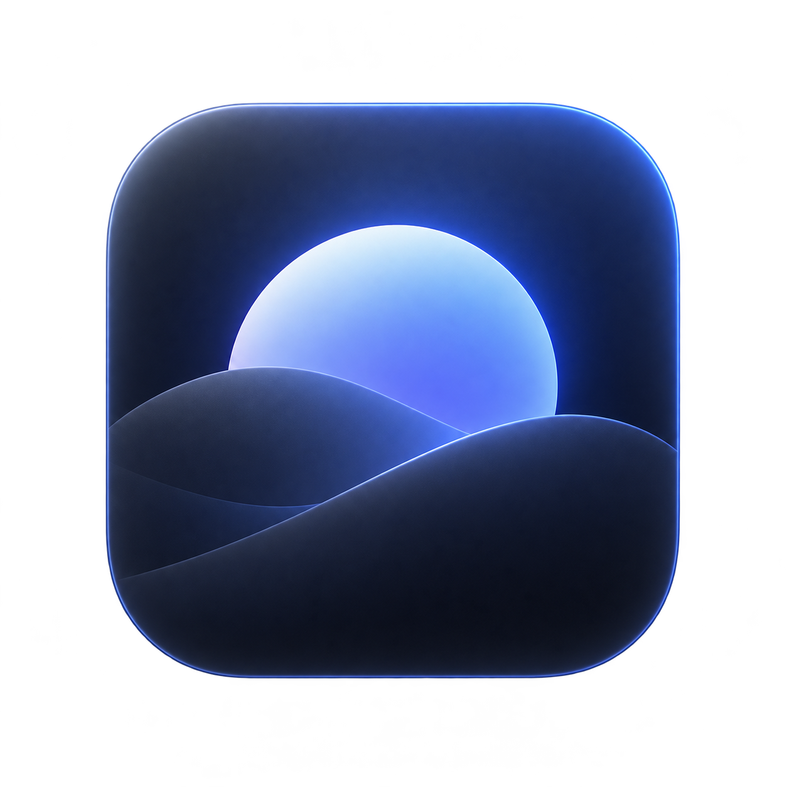

<p align="center">
  
</p>

# Deep Focus Mode

**Keep your active window in focus. Dim the distractions.**

**Etkin penceren odakta kalsın. Dikkat dağıtan alanlar kararsın.**

[](https://github.com/AlperCetinkaya/DeepFocusMode/actions/workflows/macos.yml)
[](LICENSE)

[English](#english) · [Türkçe](#türkçe)

## English

Deep Focus Mode is a free, open-source native macOS menu bar app that dims the area around your active window. Built with SwiftUI and AppKit, it works entirely offline and includes English and Turkish interfaces.

### Available now

- **Quick Focus:** turn dimming on or off from the menu bar or Settings.
- **Adjustable intensity:** choose dimming opacity from 0% to 85%.
- **Window tracking:** follow the active window as it moves or resizes, using application and Accessibility events.
- **Rounded opening:** keep the focused window bright with rounded corners. Overlays let mouse clicks pass through and never take keyboard focus.
- **Safe startup:** dimming starts off after each launch. Missing permission or unavailable window geometry removes the overlays.
- **Local preferences:** remember opacity without saving window titles, screenshots, typed content or usage history.

### Status and limitations

This is an early development prototype. The **Direct** configuration is the current working path for cross-app dimming. Sandbox-enabled builds compile, but sandbox runtime compatibility and Mac App Store distribution remain unresolved. No notarized download is available yet.

Local validation passed **13 tests**, including real AppKit overlay rendering, rounded corners, display-edge geometry and input pass-through checks. The first GitHub Actions build and test run also passed.

Full-screen windows currently suspend dimming. Multiple physical displays, Mission Control, Stage Manager and screen sharing still need manual compatibility testing. The opening uses a 12-point corner radius; apps with custom window shapes may differ.

### Build and use

Requirements: **macOS 14 or later** and **Xcode with a compatible macOS SDK**. The project has no external package dependencies.

1. Clone this repository and open `DeepFocusMode.xcodeproj` in Xcode.
2. Select the **DeepFocusMode-Direct** scheme and **My Mac**. For interactive use, choose your Apple Development signing identity in Signing & Capabilities.
3. Build and run. Open Settings from the menu bar icon.
4. Read the permission explanation, then grant access in **System Settings → Privacy & Security → Accessibility**. Return to the app and check access again; relaunch if macOS requests it.
5. Enable **Quick Focus** and adjust the intensity. Open the app again from Finder to reveal Settings when needed.

Accessibility access is used to follow window position, size and focus. Screen Recording permission is not requested. Stable certificate signing helps preserve Accessibility approval across rebuilds.

With an Apple Development identity already installed, the local build helper discovers it without storing signing credentials in the repository:

```sh
bash Scripts/build-local.sh Direct build
```

The resulting app is at `build/Direct/Build/Products/Direct/DeepFocusMode.app`. This is a local development build, not a notarized release. The interface language follows macOS app language preferences; an in-app language selector is not implemented yet.

### Planned

The first version is planned to add focus sessions, optional completion notifications, a configurable global shortcut and a choice between global and per-display focus. These features are not implemented yet.

**Phase 2:** break timers, focus/break cycles, advanced profiles, application exclusions and launch at login.

### Privacy and license

No account, backend, tracking, analytics, ads or subscriptions. The app works offline and keeps settings locally. Licensed under the [MIT License](LICENSE).

## Türkçe

Deep Focus Mode, etkin pencerenin çevresini karartarak dikkat dağıtan alanları azaltan, ücretsiz ve açık kaynaklı bir macOS menü çubuğu uygulamasıdır. SwiftUI ve AppKit ile geliştirilmiştir; tamamen çevrimdışı çalışır ve Türkçe ile İngilizce arayüz sunar.

### Şu anda kullanılabilenler

- **Hızlı Odak:** menü çubuğundan veya Ayarlar'dan karartmayı açıp kapatma.
- **Ayarlanabilir yoğunluk:** %0–85 arasında karartma seviyesi.
- **Pencere takibi:** uygulama ve Erişilebilirlik olaylarıyla etkin pencerenin hareketini ve boyutunu izleme.
- **Yuvarlatılmış açıklık:** etkin pencere aydınlık kalır; karartma katmanları tıklamaları geçirir ve klavye odağını almaz.
- **Güvenli başlangıç:** her açılışta karartma kapalıdır. İzin veya güvenilir pencere konumu yoksa katmanlar kaldırılır.
- **Yerel tercihler:** yoğunluk kaydedilir; pencere başlıkları, ekran görüntüleri, yazılan içerikler ve kullanım geçmişi kaydedilmez.

### Durum ve sınırlamalar

Proje erken geliştirme aşamasındadır. Uygulamalar arası karartma için şu anda çalışan yol **Direct** yapılandırmasıdır. Sandbox açık sürümler derleniyor; ancak bu sürümlerin çalışma uyumluluğu ve Mac App Store dağıtımı henüz netleşmedi. Henüz noter onaylı, indirilebilir bir sürüm yoktur.

Gerçek AppKit katmanlarının çizimi, yuvarlak köşeler, ekran kenarı geometrisi ve tıklamaları geçirme kontrolleri dahil **13 yerel test geçti**. İlk GitHub Actions derleme ve test çalışması da başarılı oldu.

Tam ekran pencerelerde karartma geçici olarak kaldırılır. Birden fazla fiziksel ekran, Mission Control, Stage Manager ve ekran paylaşımı için elle uyumluluk testleri henüz tamamlanmadı. Açıklık 12 punto köşe yarıçapı kullanır; özel pencere tasarımlarında köşeler farklı olabilir.

### Derleme ve kullanım

Gereksinimler: **macOS 14 veya üzeri** ve **uyumlu macOS SDK içeren Xcode**. Harici paket bağımlılığı yoktur.

1. Depoyu bilgisayarına al ve `DeepFocusMode.xcodeproj` dosyasını Xcode ile aç.
2. **DeepFocusMode-Direct** şemasını ve **My Mac** hedefini seç. Etkileşimli kullanım için Signing & Capabilities bölümünde Apple Development imza kimliğini ayarla.
3. Derleyip çalıştır. Menü çubuğundaki simgeden Ayarlar'ı aç.
4. İzin açıklamasını oku ve **Sistem Ayarları → Gizlilik ve Güvenlik → Erişilebilirlik** bölümünden izin ver. Uygulamaya dönüp erişimi yeniden kontrol et; macOS isterse uygulamayı yeniden başlat.
5. **Hızlı Odak** seçeneğini açıp yoğunluğu ayarla. Ayarlar'ı tekrar göstermek için uygulamayı Finder'dan yeniden açabilirsin.

Erişilebilirlik izni pencere konumunu, boyutunu ve odağını izlemek için kullanılır. Ekran Kaydı izni istenmez. Sabit bir sertifikayla imzalamak, yeniden derlemelerde Erişilebilirlik izninin korunmasına yardımcı olur.

Bilgisayarında Apple Development imza kimliği varsa yerel derleme yardımcısını kullanabilirsin. İmza bilgileri depoya kaydedilmez:

```sh
bash Scripts/build-local.sh Direct build
```

Derlenen uygulama: `build/Direct/Build/Products/Direct/DeepFocusMode.app`. Bu çıktı yerel geliştirme içindir; noter onaylı dağıtım sürümü değildir. Arayüz dili macOS uygulama dili tercihlerini izler; uygulama içi dil seçici henüz yoktur.

### Planlananlar

İlk sürüm için odak oturumları, isteğe bağlı tamamlanma bildirimleri, ayarlanabilir genel klavye kısayolu ve tüm ekranlarda tek odak ya da ekran başına odak seçimi planlanıyor. Bunlar henüz uygulanmadı.

**Faz 2:** mola zamanlayıcıları, odak/mola döngüleri, gelişmiş profiller, uygulama istisnaları ve oturum açıldığında başlatma.

### Gizlilik ve lisans

Hesap, sunucu, takip, analiz, reklam ve abonelik yoktur. Uygulama çevrimdışı çalışır; ayarlar yerel olarak saklanır. [MIT Lisansı](LICENSE) ile sunulur.

## Development / Geliştirme

Run the Direct test suite / Direct testlerini çalıştır:

```sh
xcodebuild -project DeepFocusMode.xcodeproj -scheme DeepFocusMode-Direct \
  -configuration Direct -derivedDataPath build/DirectTests -destination 'platform=macOS' \
  CODE_SIGN_STYLE=Automatic CODE_SIGN_IDENTITY=- DEVELOPMENT_TEAM= \
  ENABLE_TESTABILITY=YES SWIFT_OPTIMIZATION_LEVEL=-Onone test
```

| Directory / Klasör | Contents / İçerik |
| --- | --- |
| `DeepFocusMode/App` | App lifecycle and model / Uygulama yaşam döngüsü ve model |
| `DeepFocusMode/Focus` | Window tracking, geometry and overlays / Pencere takibi, geometri ve karartma |
| `DeepFocusMode/UI` | Menu and Settings / Menü ve Ayarlar |
| `DeepFocusMode/Resources` | Localizations and app assets / Çeviriler ve uygulama görselleri |
| `DeepFocusModeTests` | Rendering, geometry and safety tests / Çizim, geometri ve güvenlik testleri |
| `Scripts` | Local signing and asset helpers / Yerel imzalama ve görsel yardımcıları |

Bug reports and contributions are welcome through [Issues](https://github.com/AlperCetinkaya/DeepFocusMode/issues) and pull requests. Include your macOS version, app version or commit, affected application and steps to reproduce. Avoid sharing private window content.

Hata bildirimlerini ve katkılarını [Issues](https://github.com/AlperCetinkaya/DeepFocusMode/issues) veya pull request üzerinden paylaşabilirsin. macOS sürümünü, uygulama sürümünü veya commit'i, etkilenen uygulamayı ve sorunu tekrarlama adımlarını ekle. Özel pencere içeriklerini paylaşma.
